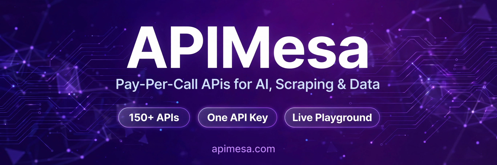

# Featured APIs

<a href="../README.md#featured-apis">Back to the main directory</a>

API Mega List keeps each featured API provider in a separate collection so their products, descriptions, and placement remain distinct.

<table width="100%">
  <tr>
    <td width="100%" align="center" valign="top">
      
    </td>
  </tr>
  <tr>
    <td width="100%" align="center" valign="top">
      <h3>APIMesa API Marketplace</h3>
      
<strong>150+ APIs</strong>

      
Pay-per-call AI, scraping, data extraction, SEO, lead generation, media, and developer APIs — one key, clear credit pricing, live playground.

      
<a href="./apimesa-marketplace-apis/"><strong>Browse APIMesa APIs →</strong></a>

    </td>
  </tr>
</table>

<table width="100%">
  <tr>
    <td width="100%" align="center" valign="top">
      <h3>ApyHub Utility API Collection</h3>
      
<strong>200 APIs</strong>

      
Certified utility APIs for AI, files, data extraction, validation, SEO, HR, marketing, and application utilities. One subscription, MCP-ready.

      
<a href="./apyhub-utility-apis/"><strong>Browse ApyHub APIs →</strong></a>

      
<a href="https://apyhub.com?fpr=chris-2f0318">Visit ApyHub →</a>

    </td>
  </tr>
</table>

Placement order is set by the sponsor agreements: the top sponsor leads, followed by the featured collections below. See the repository's [sponsored partner placement policy](../SPONSORED_PARTNERS.md).
